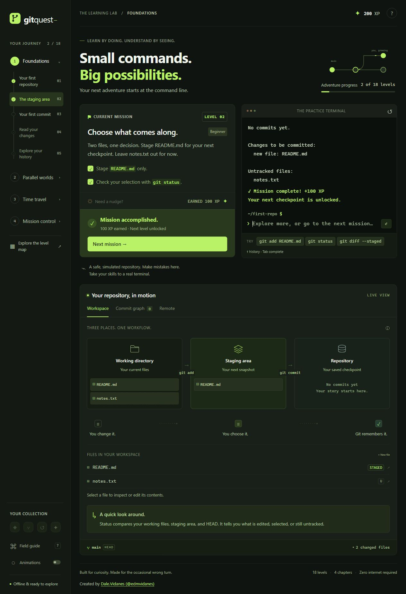

# GitQuest

Learn Git through an offline adventure: **18 interactive levels, four chapters, and a repository you can see in motion.**

## Objective

Build confidence with Git by completing small missions and watching what each command changes. GitQuest uses a safe, simulated repository to teach the working directory, staging area, commits, branches, collaboration, and recovery from mistakes.

Each level gives you a goal to solve in the practice terminal. Animated visuals explain the result, and completing a chapter opens a recap of the concepts and commands you learned, with optional links to the official Git documentation.

## Your learning journey

| Chapter | Levels | What you practice |
| --- | --- | --- |
| Foundations | 1–5 | Initialize a repository, inspect status, stage files, commit, read diffs, and explore history. |
| Parallel worlds | 6–10 | Create and switch branches, merge changes, and resolve conflicts. |
| Time travel | 11–15 | Stash work, restore files, unstage changes, reset commits, and revert safely. |
| Mission control | 16–18 | Connect a simulated remote, push, fetch, pull, and finish with a tagged release. |

## Play offline

1. Download [`index.html`](https://github.com/edmvidanes/GitQuest/raw/refs/heads/main/index.html).
2. Open it in a modern browser.
3. Follow the mission, enter commands in the practice terminal, and watch the repository change.

**Only `index.html` is needed to run the game.** All scripts, styles, icons, lessons, and animations are embedded. No Git installation, build step, external library, or backend is required. The README and screenshot document the project; they are not runtime dependencies.

The terminal simulates Git for learning. Use a real Git repository when you are ready to practice outside the game. Optional documentation and creator links need internet access.

## Saved progress

Progress saves automatically in browser local storage, including your current level, XP, badges, and practice repository. Returning in the same browser restores your adventure.

Each browser and website domain has its own save. Clearing site data removes that save; private browsing may keep it only for the session. The downloaded file and a hosted website have separate saves.

## Host on S3

- Upload **only `index.html`** to your S3 bucket with Content-Type `text/html; charset=utf-8`.
- For S3 static website hosting, enable website hosting and set the index document to `index.html`.
- For a custom domain with HTTPS, use CloudFront with an ACM certificate and point your domain to the distribution. Set CloudFront’s default root object to `index.html`.

The game also works on other static hosts and under a website subpath. Hosting serves the file; progress remains in each learner’s browser.

---

Created by **[Dale.Vidanes](https://github.com/edmvidanes)** · GitHub: **[@edmvidanes](https://github.com/edmvidanes)**
